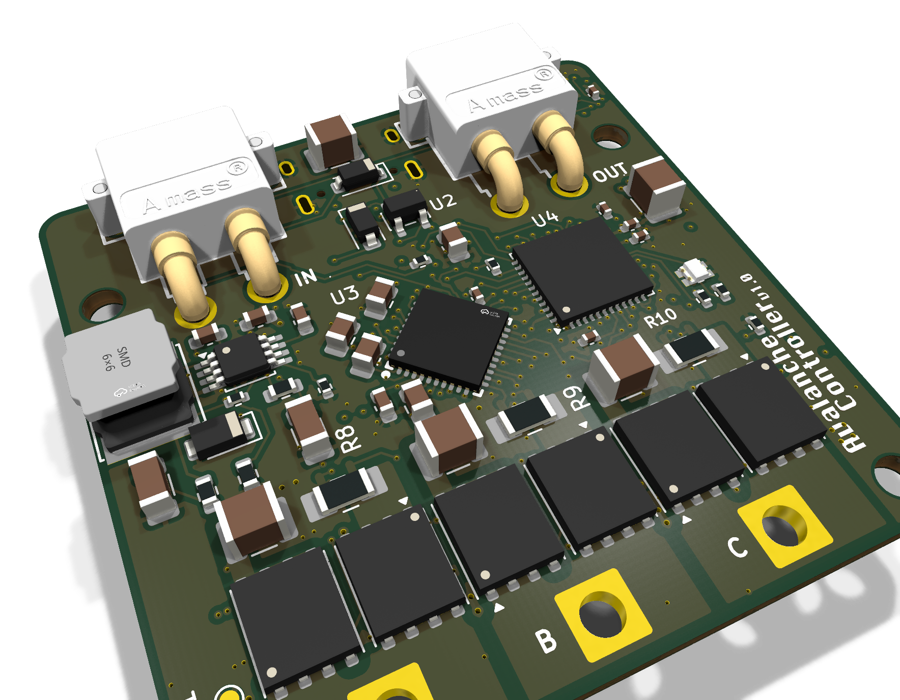
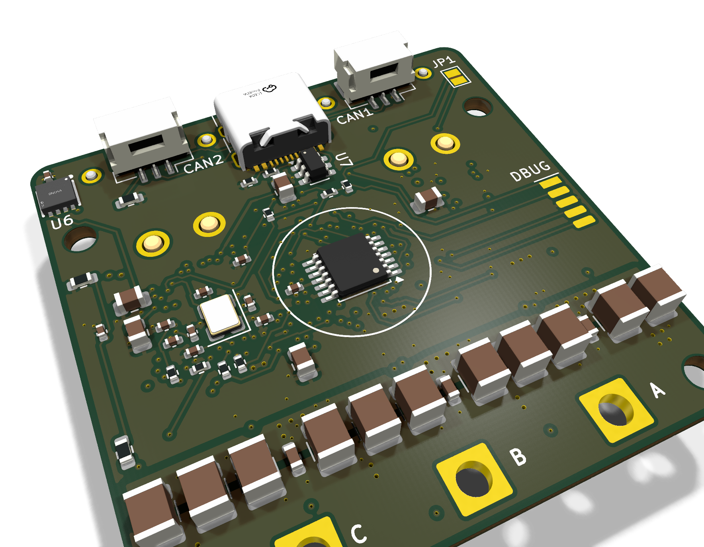

+++
title = "Agentic PCB Development"
date = 2026-10-29
tags = ["PCB", "KiCad", "AI Agents", "FOC", "PMSM Controller", "project"]
+++

## Background

Recently I started designing a control board for hobby-style brushless motors. Part of this requires actually developing a PCB: schematics, component placements, and traces. In my daily work life as a software engineer, I have re-structured my workflow to leverage the power of AI Agents: I use agentic skills and loops to fully automate any manual and high-effort tasks, for example the act of writing software.

Agents excel in this kind of work: repetitive, high-effort (for a person), and testable tasks. Since I have not touched KiCad in several years, I thought I would develop an agentic harness to do just that: build the PCB for the motor controller.

## Requirements

The overarching goal of this is to have a skill that is able to take a design spec and create a PCB that can be manufactured. With this in mind, the concrete requirements are:

- The agent must be able to build a schematic from a design specification and part numbers.
- The agent must be able to take the schematic and create a PCB with correct component placement and 100% wiring.
- The agent must follow correct conventions when placing traces: for example ensuring trace width for high power components, using fills, using vias when needed.

## The Solution: Skills

To address this I created 2 skills: `/to-schematic` and `/to-layout`. Each skill takes one document as an input and produces one reviewed artifact as output (e.g. schematic, Gerber files, etc.).

Both skills share a few principles:

- **Has a "Persona".** `/to-schematic` acts as a *senior electrical engineer*: every part is justified, and every value comes from a datasheet or a calculation. `/to-layout` acts as a *PCB engineer* with a power-electronics background. Its core rule is that every number (trace width, clearance, via size, distance) is *chosen*, never left at the default.
- **Native KiCad files.** The schematic is written with `kicad-sch-api` and the board is scripted with KiCad's own Python API (`pcbnew`). I can open any of it in KiCad and edit it by hand.
- **Check gate.** Every pass, revision or update runs ERC to ensure everything is valid. Essentially like running a unit test suite.

### /to-schematic

**Purpose:** turn the design doc into a KiCad schematic where every part and pin is checked against its datasheet.

### /to-layout

**Purpose:** turn the approved schematic into a placed, fully routed PCB that is ready to manufacture.

1. **Board setup.** Ask the board-level questions up front (copper weight, temperature rise, swappable pins), then compute trace widths from the currents.
2. **Placement, with checks.** Big parts first, then parts with lots of connections (e.g. MCUs), then small parts.
3. **Route critical copper by script.** Power stage, gate drive and current-sense pairs go in first, followed by a check that each power path can carry its current through the actual copper and vias.
4. **Route the rest in stages.** Most constrained first, each stage locked once DRC is clean. An autorouter is only a fallback.
5. **Manufacturing files on request.** Gerbers, drill files, and the BOM and placement files for JLCPCB.

The skills grew over time. I ran into several challenges, so I had to create several "bespoke" scripts to handle these edge cases. All of these are referenced by the `/to-layout` skill. See the **Challenges** section.

## Example Usage

I built these skills for my [FOC motor controller project](https://github.com/mAzurkovic/foc). The board is a 45 × 45 mm controller for hobby brushless motors.

Before any hardware work, I wrote the requirements and the design doc with my [design-workflow skills](https://github.com/mAzurkovic/skills/tree/main).

**Step 1:** run `/to-schematic`

**Step 2:** run `/to-layout`

**Results:** the FOC controller came out as a 45 × 45 mm, 6-layer, two-sided board:

- DRC: 0 errors, 0 unconnected
- Schematic/PCB parity: 0 mismatches
- Lint: 0 findings
- Power paths: checked against the 10 A continuous rating

## Challenges

Right off the bat I ran into several challenges. All of them were in layout and routing.

### 1. Routing Could Never Finish

**Problem:** The agent would place parts, run Freerouting and come back with dozens of unrouted nets.

**Root Cause:** The board was unroutable because of where the parts were, not because the router needed more time. For example, not orienting MCUs correctly to optimize paths.

**Fix:** I added checks before any routing starts:

- **"Untangle" step:** tries all four rotations of each chip and keeps the one with the fewest crossing connection lines. It also proposes swapping equivalent pins, which go back to the schematic for approval.
- **Space check:** estimates whether the board can fit all its wiring before small parts are placed (a congestion map from a global router, plus escape and corridor budgets around the fine-pitch chips).
- **Hand-off rule:** if more than ~20 nets are still unrouted after two Freerouting runs, the agent stops and asks for help instead of looping.
- In the end, the honest fix was going from 4 layers to 6.

### 2. Early Traces Block Later Ones

**Problem:** Routing all nets in one pass never worked. Every failure had the same shape: copper laid down earlier boxed in a pin that a later net needed to reach.

**Root Cause:** The order of traces matters. Similar example as above: an MCU with lots of traces would box in power traces, or vice versa.

**Fix:** Route in stages, hardest first, and lock each stage only once KiCad's design-rule check (DRC) is clean.

## Learning

**PCB placement is an artform:** Although we use PCBs in engineering work and there are always conventions to follow, placing components and wiring them is more of an artform. For this reason, it makes it difficult to create guardrails for an agent to follow when it tries to place and wire components.

**The agent has to see the board:** Every skill ends with a check script (`tools/render`) that renders PNGs, and the agent has to look at them, not just read the error counts. Combined with visual diffs between commits, that's what made the agent's PCB output reviewable like a code PR.
