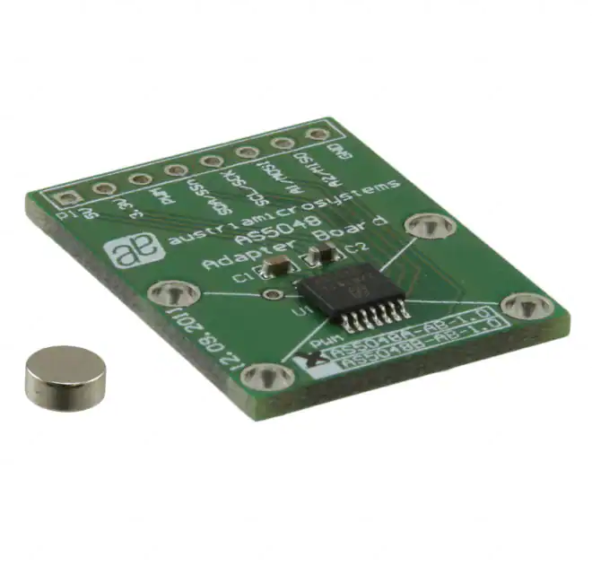
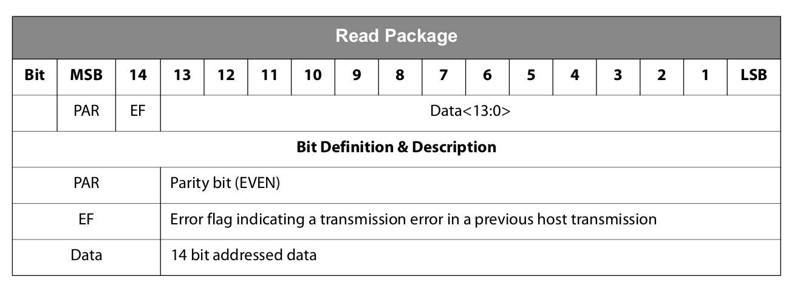

+++
title = "AS5048A Magnetic Encoder and STM32"
date = 2021-10-07T22:14:00.002-07:00
tags = ["AC", "AS5048A", "Motor Drive", "PMSM Controller", "project", "Sensor", "SPI"]
+++

This past week I began to write the controller firmware - mainly playing with the AS5048A angular position sensor from AMS. Here is the [datasheet](https://ams.com/documents/20143/36005/AS5048_DS000298_4-00.pdf/910aef1f-6cd3-cbda-9d09-41f152104832).

This sensor will be used to get the rotor position and then compute the resulting electrical angle for the Clarke/Park transforms and also it will be used to find rotor speed for the out loop.

I will be using an STM32F446 board to run the loop as it has a high clock speed. The AS5048A sends its measurements over SPI. Below is the read package sent from the sensor:

We get 14 bits of position data - aka 16384 ticks per revolution, or a resolution of 0.0219 degrees.

I wrote this read()function that sends the SPI command package and reads the resulting response:

uint16\_t read(uint16\_t registerAddress) {

uint16\_t command = 0x4000; // PAR=0 R/W=R

uint8\_t RxBuff[2];

uint8\_t TxBuff[2];

command = command | registerAddress;

command |= (uint16\_t) (spiCalcEvenParity(command) << 0xF);

TxBuff[0] = command >> 8;

TxBuff[1] = command & 0xFF;

// Send 16-bit SPI command

HAL\_GPIO\_WritePin(SPI3\_SEL\_GPIO\_Port, SPI3\_SEL\_Pin, 0);

HAL\_SPI\_Transmit(&hspi3, (uint8\_t \*)&TxBuff[0], 1, 100);

HAL\_SPI\_Transmit(&hspi3, (uint8\_t \*)&TxBuff[1], 1, 100);

HAL\_GPIO\_WritePin(SPI3\_SEL\_GPIO\_Port, SPI3\_SEL\_Pin, 1);

// Receive 16-bit SPI response

HAL\_GPIO\_WritePin(SPI3\_SEL\_GPIO\_Port, SPI3\_SEL\_Pin, 0);

HAL\_SPI\_Receive(&hspi3, (uint8\_t \*)&RxBuff[0], 1, 100);

HAL\_SPI\_Receive(&hspi3, (uint8\_t \*)&RxBuff[1], 1, 100);

HAL\_GPIO\_WritePin(SPI3\_SEL\_GPIO\_Port, SPI3\_SEL\_Pin, 1);

return ((RxBuff[0] << 8) | RxBuff[1]) & ~0xC000;

}

It pretty much takes the desired register to be read on the AS5048A (for angle it is 0x3FFF), computes the parity, and uses the built in STM32 HAL methods to transmit and receive the data. The timing/order took me a bit to figure out since STM32 is configured by default to send 8 bit words while the sensor uses 16 bits - as you can see I ended up splitting it into 2 single byte transmits/receives. 

I plan on posting the code on GitHub later.
