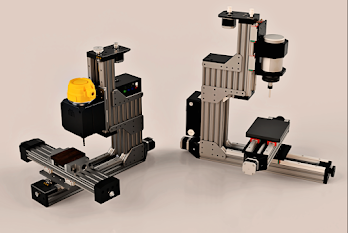
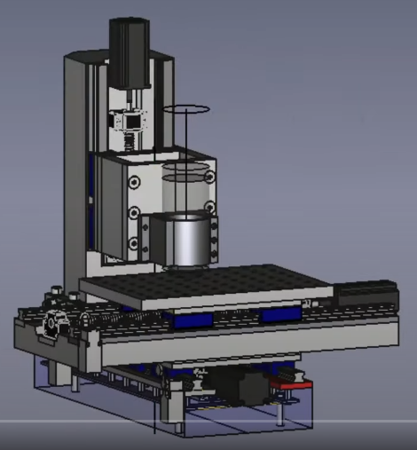
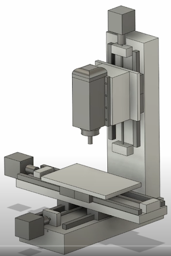

+++
title = "First Post for a DIY CNC Machine"
date = 2021-09-08T20:41:00.002-07:00
tags = ["CNC", "mill", "project"]
+++

I have been wanting to have access to a CNC machine for milling materials. There are several good options available however I think it would be interesting to design and develop one from scratch while also it being cheaper.

I need to flesh out the requirements for this project however at a high level the CNC machine should be able to:

- Mill aluminium parts at decent speeds
- Have a cost of ~\$1500 CAD
- Be compact to fit in my laundry or garage

While looking online there are several good designs that hobbyists use to create their CNC mills.

