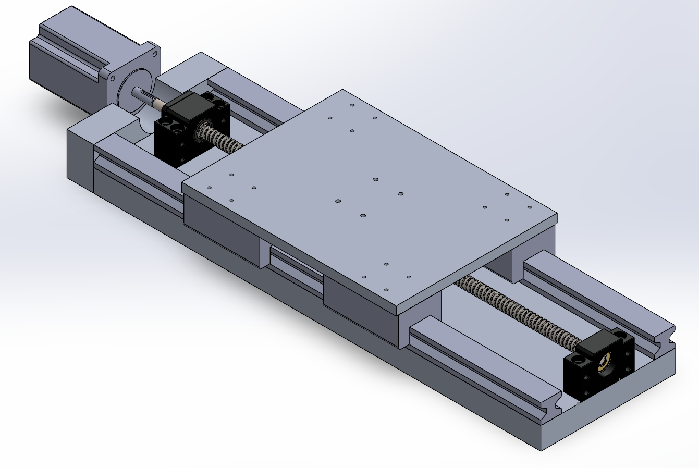

+++
title = "CNC Mill Axis Assembly Updates"
date = 2021-09-13T22:07:00.003-07:00
tags = ["CAD", "CNC", "design", "mill", "project", "Solidworks"]
+++

In the previous post I mentioned my concerns with the height and amount of parts needed for each axis assembly. The main problem was due to the ball screw (SFU1204) alignment bearings being tall (39 mm). This meant the guide rails and linear bearings needed to match that height in order for the table to clear (to get the full build area range).

Here is the updated design:

The SFU1204 ball screw is being used, along with the BF/BK10 end housings. However, instead of MGN15H linear rails and bearings, a higher profile HGH 25 rails are being used with HGH 25CA linear bearings ([linked here is the plan](https://www.aliexpress.com/item/1005001597258922.html?spm=a2g0o.productlist.0.0.13f43f20SdjOhC&algo_pvid=ec6a0915-6b43-444c-b9c2-86136c461d7d&algo_exp_id=ec6a0915-6b43-444c-b9c2-86136c461d7d-11&pdp_ext_f=%7B%22sku_id%22%3A%2212000017446206167%22%7D)). The total height of bearing on rail is 40 mm, which gives 1 mm of clearance which should be enough (if not i can purchase precision [1-5 mm spacers](https://www.aliexpress.com/item/32961382024.html?spm=a2g0o.productlist.0.0.fa646ecfhxgI13&algo_pvid=27afc59b-bcc4-4a1e-985e-2e0f537e1ddf&aem_p4p_detail=202109132200533101173026187140075773395&algo_exp_id=27afc59b-bcc4-4a1e-985e-2e0f537e1ddf-0&pdp_ext_f=%7B%22sku_id%22%3A%2266430723709%22%7D)).

Another change is the motor mount. This should be easier to fabricate out of a piece of aluminium with the tools at hand. The pre-made OTS components per axis are now:

- SFU1204 ball screw
- BF/BK10 housing
- 2x HGH 25 rails
- 4x HGH 25CA linear bearings

The custom parts that need to be cut out of aluminium (besides the bed) are:

- NEMA 27 motor plate/mount
- Ball nut housing
- Main saddle

With these modifications, the x-travel (since the above is for the x-axis assembly) is 240 mm (~10 inches).
