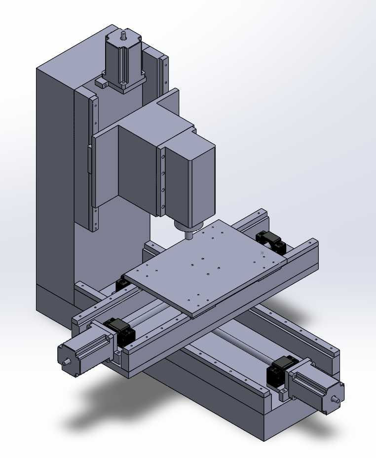
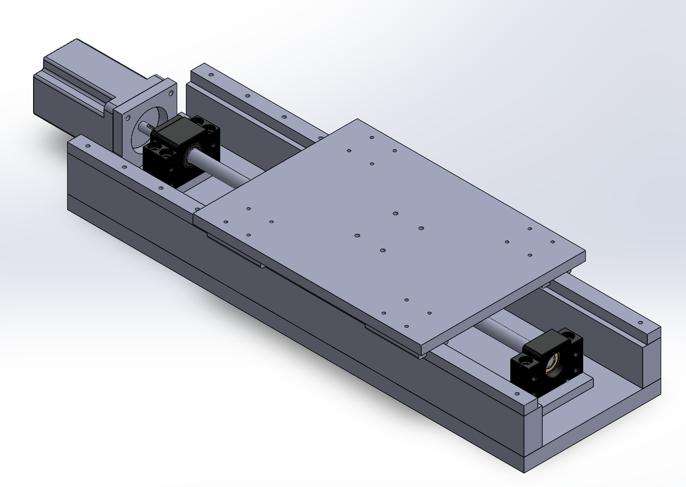
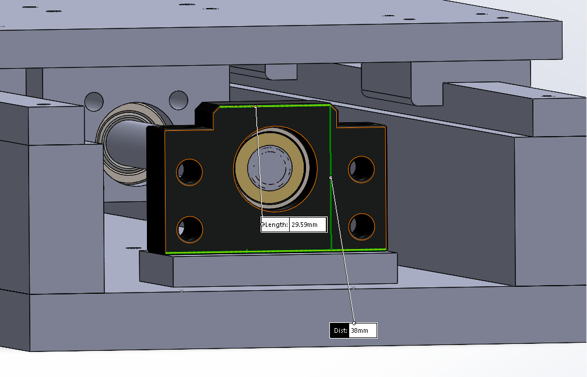

+++
title = "CNC Mill CAD Design"
date = 2021-09-11T17:53:00.002-07:00
tags = ["CAD", "CNC", "design", "mill", "project", "Solidworks"]
+++

I started the CAD design for the CNC mill. I had several requirements and goals in mind that led the design process.

- The mill can be constructed with the tools available to me
- Minimal parts
- Re-usability of sub-assemblies
- Strong frame

I came up with this design. The work area is 250 x 180 x 150 mm in the x-y-z directions respectively. I mostly focused on the x and y axes and need a better design for the z gantry where the spindle is attached. There are some shortcomings which will be discussed below.

I started by designing the x-axis and by picking which OTS components I would need. I went with a ball screw (the SFU1204 standard) and a pair of 15 mm linear rails with MGN15H trucks. The reason why I went with a ball screw over a lead-screw is for the precision and rigidity benefits and also being able to back drive the table if needed.

The design works well however with the ball screws, the guide bearing assembly is quite large/tall which means that I have to lift the linear rails so there is enough clearance for the table to reach the entire workspace.

*The BK/BF guide bearing assembly is 38 mm in height.*

To lift the linear rails the plan is to machine a precision aluminium bar to match the ball nut housing to be level with the linear rail trucks. This is not ideal since the whole assembly will be less rigid so another option is to add aluminium precision spacers on the trucks them-selves, and mount the linear rails directly on the base aluminium plate. In the image above there are also aluminium spacers to mount the BK/BF higher such that it is aligned with the motor.

Other than that the design is sound and each x-y-z assembly are relatively the same - the only differences are the ball screw travel.

In terms of the OTS parts, here is a list on what I am thinking (besides the aluminium stock and fasteners):

- [SFU1204 Ball Screws](https://www.aliexpress.com/item/1005002477029778.html?spm=a2g0o.productlist.0.0.3a8849afyGIiWR&algo_pvid=59a83b84-7a91-4a19-9884-ed9f0ab45044&aem_p4p_detail=202109061133367945158265344320025914481&algo_exp_id=59a83b84-7a91-4a19-9884-ed9f0ab45044-2&pdp_ext_f=%7B%22sku_id%22%3A%2212000020963113635%22%7D)
- [Rails and MGN15H](https://www.aliexpress.com/item/4000264234020.html?spm=a2g0o.productlist.0.0.2e9d4a30yfzV7P&algo_pvid=0d8aee83-fa15-4440-8ec7-41d1d45a282e&aem_p4p_detail=202109061211004984499684834560025967752&algo_exp_id=0d8aee83-fa15-4440-8ec7-41d1d45a282e-0&pdp_ext_f=%7B%22sku_id%22%3A%2210000001071265899%22%7D)
- [Spindle](https://www.aliexpress.com/item/32469085433.html?spm=a2g0o.search0304.0.0.61647e7aO65HmV&algo_pvid=2c57b768-4e0f-4fc1-80a2-cee2a758598e&algo_exp_id=2c57b768-4e0f-4fc1-80a2-cee2a758598e-13)
- NEMA 27 Steppers
