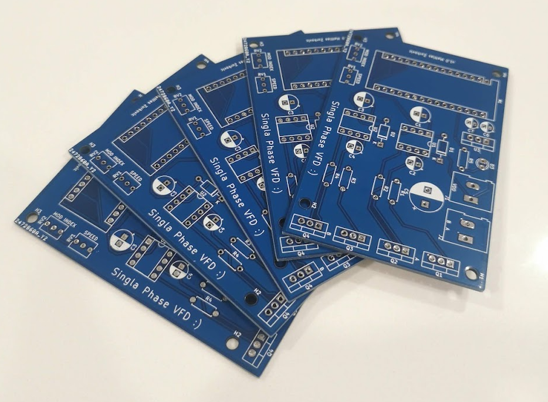
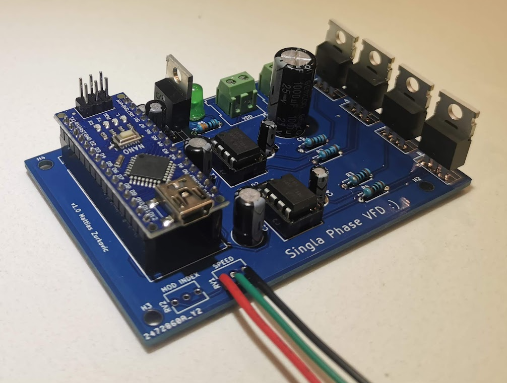
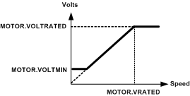

+++
title = "Completion of the VFD - PCB and Demo"
date = 2021-12-13T10:45:00.002-08:00
tags = ["AC", "Induction Motor", "Motor Drive", "PCB", "VFD"]
+++

This past week the PCB order was delivered from JLCPCB. The traces came out great:

*The VFD PCBs*

I used THT components since I was not familiar with JLC's SMT service and I had plenty of the required components stocked. From the image below, the modulation index (MOD INDEX) potentiometer is not being used since I decided manual amplitude adjustment is not required.

*The assembled PCB with component*

The VFD uses open loop volts/frequency (V/Hz) control. In a nutshell, V/Hz control works to keep the ratio between applied voltage and frequency constant such that the flux in the rotor is constant. This means that across different speeds a constant torque is applied:

$$
\phi = \frac{V}{4.44 f K T}
$$

For this motor the V/Hz ratio is $120 V / 60 Hz = 2$. This means that is the frequency is increased by 1 Hz, the voltage is increased by 2 V.

*Induction motor speed vs voltage characteristic*

From the graph above, in the linear region, this V/Hz ratio can be seen as the slope of the line. For the firmware, a modified version of Kurt Hutten's Arduino SPWM code was used ([linked here](https://github.com/Irev-Dev/Arduino-Atmel-sPWM)). Putting it all together here is a quick demonstration of the system in action:

<iframe src="https://www.blogger.com/video.g?token=AD6v5dybqs0-0dYbFN7Q-HWgOh_KNR_kqkhzJwpmNIqjHJuQPSvWFjPQvd6nid0MPIo4LYsRu9Uo8hjufWDTLZZ4Aw" width="640" height="360" allowfullscreen></iframe>

*System demonstration of the VFD*

In terms of next steps, I would like to explore the field weakening range to get higher than rated speeds and also create an enclosure for the VFD (maybe also add an LCD screen to get system telemetry). For now I consider this project complete. The source files can be found on [Github](https://github.com/mAzurkovic/vfd).
