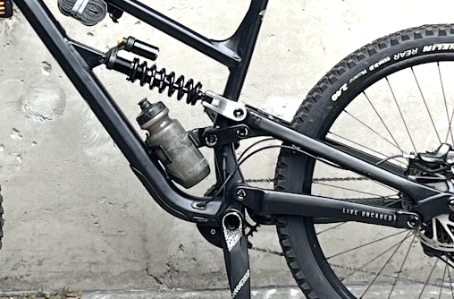
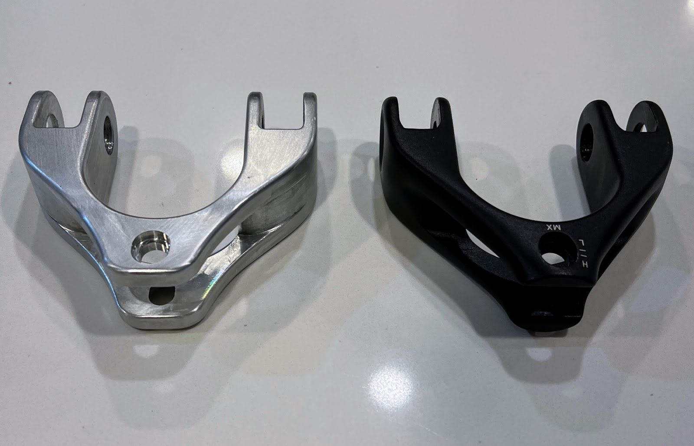
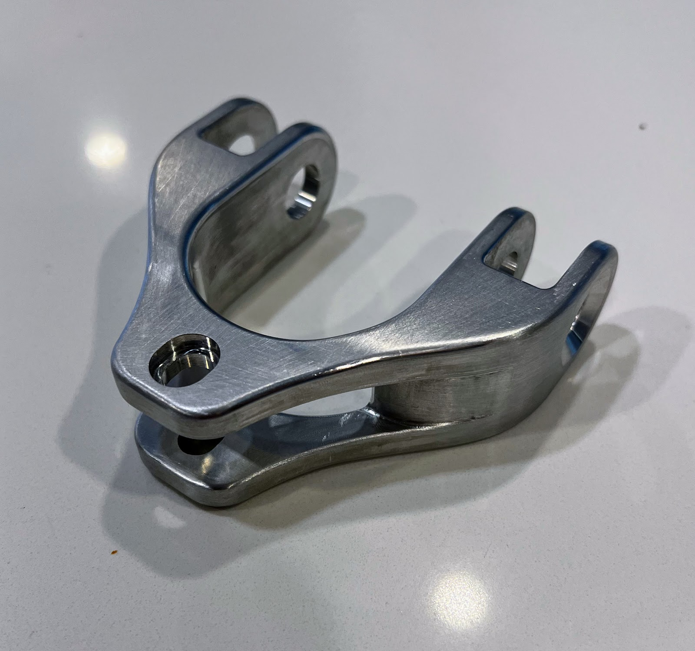
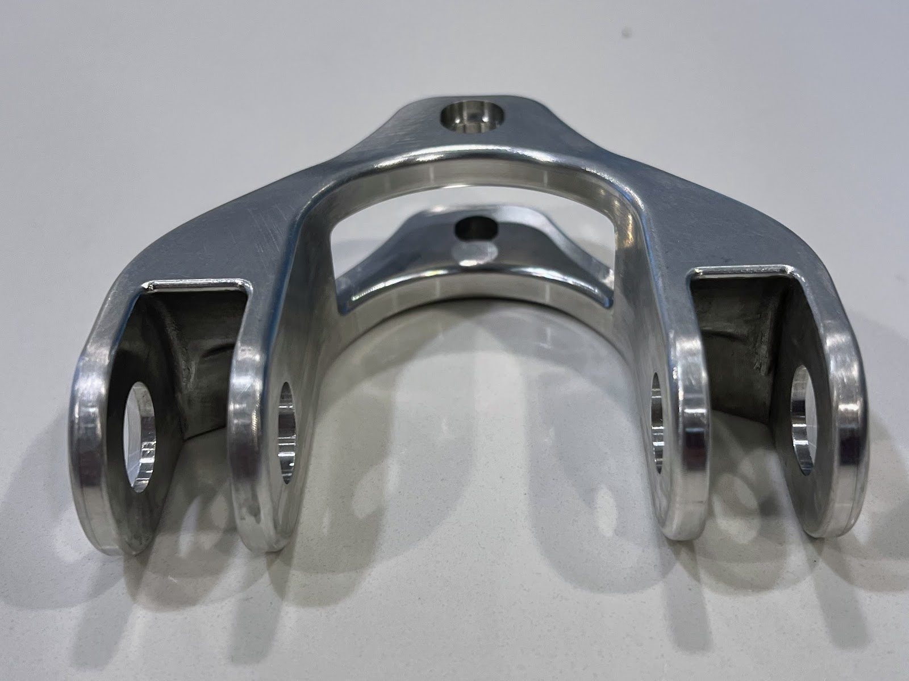
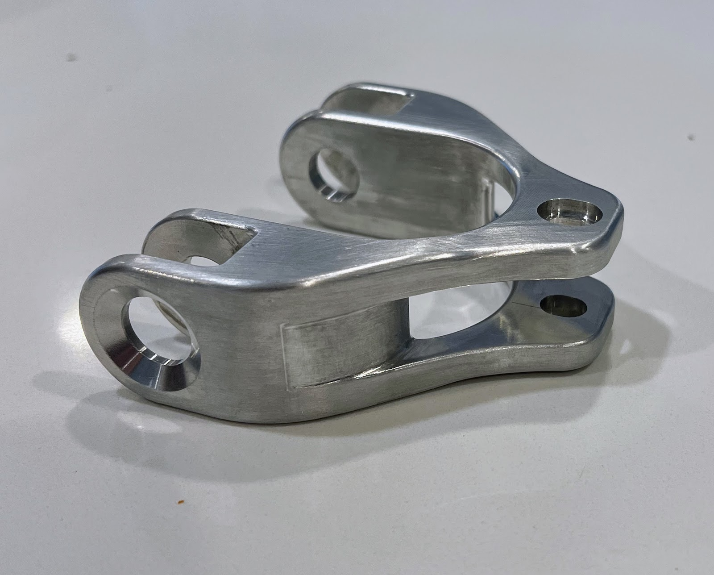
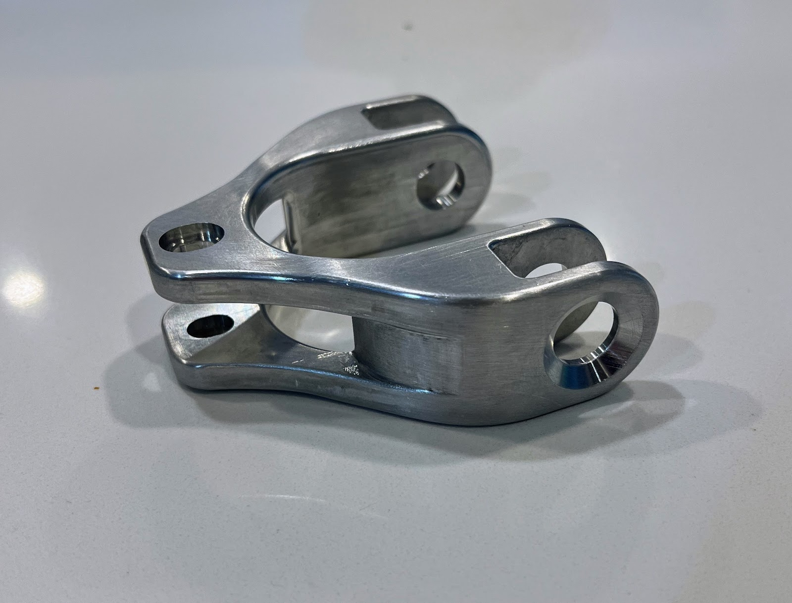

+++
title = "Custom Mountain Bike Suspension Yoke"
date = 2024-05-05T10:37:00.000-07:00
tags = ["CAD", "CNC", "MTB"]
+++

### Project Goal

- Test CNC capabilities and quality of JLC PCB's CNC machining service

The part I decided to design is a replacement suspension yoke for my YT Capra Core 2, here is the final result mounted on the bike:

### The Process

- Took off existing suspension yoke from mountain bike
- Re-model it in Solidworks
- 3D print to test fitting on bike
- Generate engineering drawings for tolerances and threads
- Upload to JLCPCB for quote - it was ~\$60 USD
- Wait 1.5 weeks for it to arrive

### Results

The machined yoke from JLC PCB (left), the existing yoke from factory (right)

- The original yoke was made from Aluminium, not sure the specific alloy so I requested 6061 as most bike manufactures use that
- The mass is ~50g lighter than the original yoke - due to a slightly modified design
- I have been riding it and so far no issues. Simulation indicated all experiences loads are within the capabilities of 6061 Al.

### CAD Model
