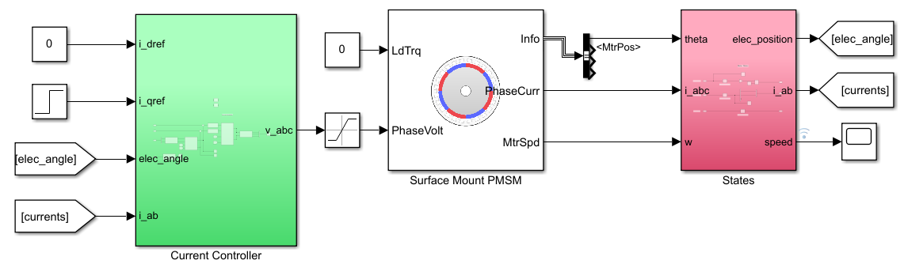
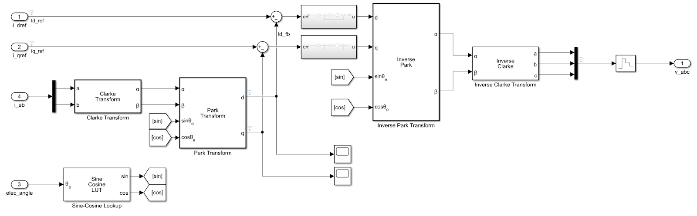
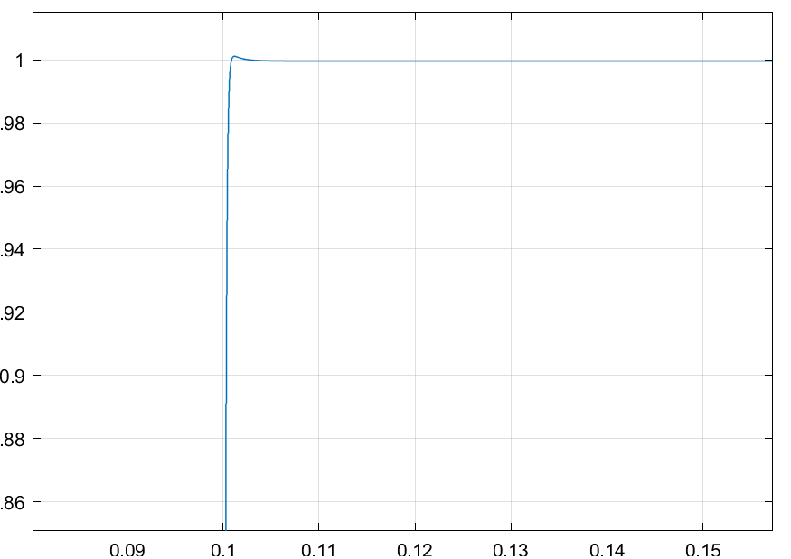
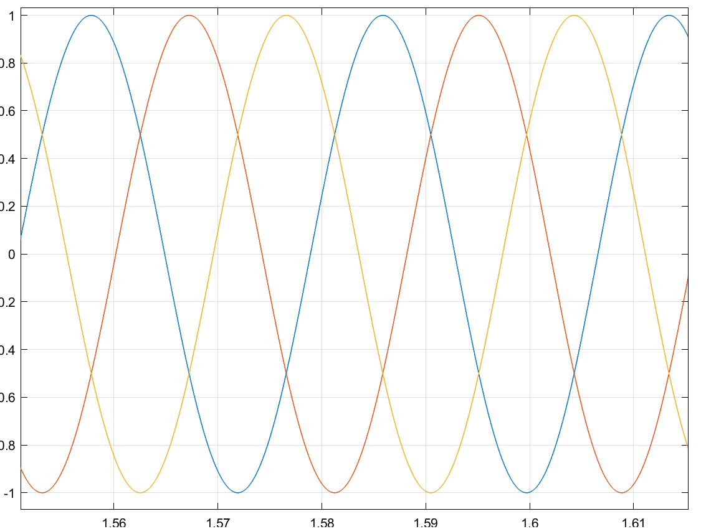

+++
title = "First Post on a AC Servo Drive Project + Current Loop Simulation"
date = 2021-09-20T22:27:00.002-07:00
tags = ["AC", "FOC", "Motor Drive", "PMSM Controller"]
+++

## Introduction

Over the past year I have been working on a motor driver for an AC hobby motor (total time about a month due to school and work) - I decided to document my past developments and continue the project as I am less busy. I looked back and refined what I wanted out of this motor drive.

**Requirements**

- Have precise control of position, speed, and torque of an AC motor
- No torque ripple in output
- Controller should be suitable for a wide range of PMSM motors

**Goals**

- Small PCB footprint (~50 mm squared)
- Develop software to tune controller profiles and gains

**Constraints**

- Design drive for permanent magnet synchronous machines (PMSM) with surface mounted magnets (non-salient motor)
- Use field oriented control (FOC) to modulate phase currents
- End board should be <\$100 CAD

To clarify, these PMSMs are hobby grade motors used for drones/UAVs, however the goal is to make it work with any sinusoidally wound brushless motor.

## Controlling Current

To drive an AC motor, the three phase currents must be applied in a controlled fashion. There are several ways: one way is 6-step commutation, which is good for high speed applications however it produces a noticeable torque ripple. Another is sinusoidal commutation which gets rid of the torque ripple, however performs worse at high speeds. The solution chose (and mentioned in the constraints) is to implement *Field Oriented Control* (FOC) as it mitigates all these issues - maximum torque with no ripple, and precise control over a wide range of speeds.

I won't explian FOC in-depth here, however here were some resources that helped me understand it.

- [Dave Wilson's TI videos](: https://www.youtube.com/watch?v=cdiZUszYLiA)
- [James Mavey's report](https://krex.k-state.edu/dspace/bitstream/handle/2097/1507/JamesMevey2009.pdf?sequence=1&isAllowed=y)
- [Ned Mohan's textbook on AC drives](file:///C:/Users/Mattias%20Zurkovic/Downloads/9781119969242%20(2).pdf)

At a high level FOC works as follows:

1. Measure incoming phase currents and rotor position
2. Transform these three phase currents into two phase currents using the *Park Transform*
3. Transform the two phase currents to a stationary reference frame using the *Clarke Transform*
4. Now the currents can be viewed as DC variables - apply a PI controller to regulate these two currents ($i_q$ and $i_d$ for quadrature and direct axes respectively).
5. These PI controllers produce a correction voltage, which is still in the DC frame, so use the *Inverse Clark*, then*Inverse Park* transforms to turn the correction voltages to AC
6. Using PWM, modulate these signals onto the legs of a three phase inverter to spin the motor.

## FOC Simulation - Current Loop

I simulated the current loop in Simulink (view the files [here on Guthib](https://github.com/mAzurkovic/foc-controller)). I am using a default PMSM motor model however I as simulating using a Teknic-2310P for motor constants (i.e. resistance and flux values). I will go more in-depth later on tuning the PI regulators, however there is a deterministic way of picking them (view Dave Wilson's blog on TI).

Here is the top level model:

Here is the step response for the quadrature axis current for a 1 A step:

This response is pretty high bandwidth which is needed to follow the cascaded speed and position loops to come. Also the three phase currents at steady state are all sinusoidal shifted by 120 degrees, which is expected.

