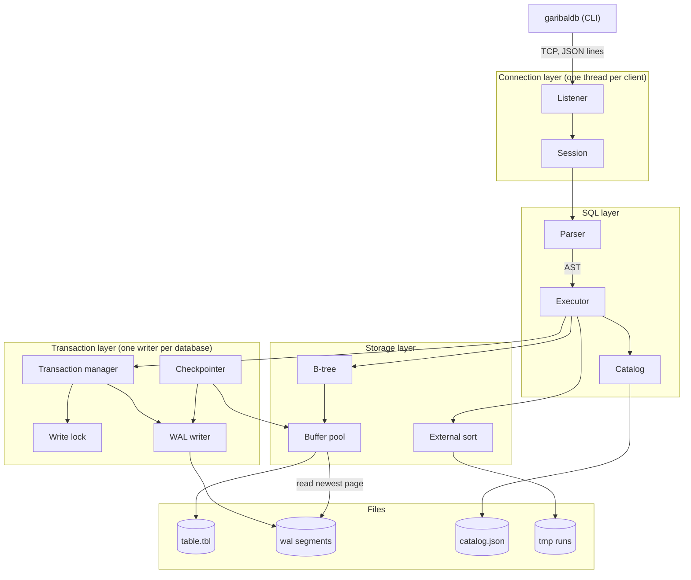
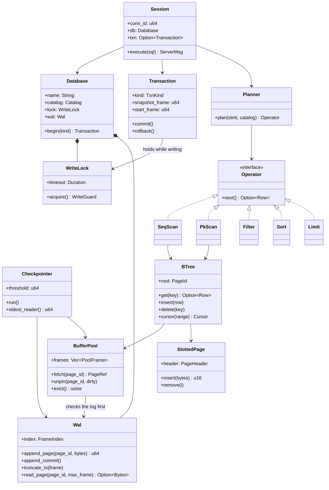

+++
title = "Building a Database in Rust from Scratch - GaribalDB"
date = 2026-10-22
tags = ["Rust", "Database", "project"]
+++

## Background

One of the main pieces of advice I give as a software engineer is to understand the fundamentals. A piece of advice I have heard that is similar is "understand the layer below". Essentially, to know how the tools and systems you use are actually built. The main advantage I have noticed in this comes up during the decision making process during design reviews. For example, when evaluating several technologies, knowing the layer below helps drive which criteria actually matter.

In this spirit I wanted to build a transactional database, as this touches everything from disk IO, memory, networking, performance, and more.

I also wanted a project so I could learn the Rust programming language. Building a low level, high performance system like a database seemed the best way to do this.

## The Outcome - GaribalDB

The code is on GitHub: [github.com/mAzurkovic/garibaldb](https://github.com/mAzurkovic/garibaldb)

A single-node SQL database server. Clients connect over TCP and send SQL. Tables are B-trees in paged files. One writer for each database gives serializable transactions, and readers see a snapshot, so they never wait.

No ORM, no embedded engine, no SQL library. The parser, the B-tree, the buffer pool, the write-ahead log, and the wire protocol are all written here.

Written in Rust.

You may be asking about the name? It comes from Mount Garibaldi, a stratovolcano in the Coast Mountains of British Columbia which I always admire on my drives up and down the Sea2Sky.

## Design

A query takes a simple path through the server. The client sends SQL over TCP. The server parses it, makes a plan, and runs that plan as a chain of small operators. Each operator pulls one row at a time from the one below it, and the bottom of the chain reads rows out of B-trees stored in 8 KB pages on disk. Rows go back to the client as soon as they are ready, so the server never holds a whole result in memory.

### System Diagram

- **Connection layer:** one thread for each client. It reads a message, runs it, and writes the rows back.
- **SQL layer:** a hand-written parser turns SQL into a tree, and the executor builds the chain of operators (scan, filter, sort, limit, project).
- **Transaction layer:** one write lock for each database, plus the write-ahead log (WAL) that makes commits survive a crash.
- **Storage layer:** the B-tree, a fixed size buffer pool that caches pages in memory, and an external sort for sorts that do not fit in memory.

### Class Diagram

The main types in the engine and how they connect. Each layer has a full diagram in the repo's [internals doc](https://github.com/mAzurkovic/garibaldb/blob/main/docs/internals.md).

### Tradeoffs

Every design choice gives something up. These are the main ones, and why I made them.

**1. One writer per database, and readers read a snapshot.**
Only one transaction can write to a database at a time. The other choice is row level locks or full MVCC, which let writers run side by side. One writer is much simpler: transactions are serializable for free, and there are no deadlocks to detect. Readers take no lock at all. They remember how far the log went when they started and only read up to that point, so a long read never blocks a writer. The cost is that writes do not run in parallel, so a busy database with many writers will queue up.

**2. A redo-only write-ahead log.**
A changed page is added to the end of the log instead of being written into the table file. The table file only ever holds committed data. This means a rollback just cuts the log back to where the transaction started, and recovery after a crash just replays the log up to the last commit. The other choice is ARIES, which has both redo and undo and is much harder to get right. The cost: one big transaction has to fit in the log (8 GB by default), and a long running reader stops the log from being cleaned up, so the log keeps growing until that reader is done.

**3. A B-tree on disk with 8 KB pages.**
Keeping every row in memory would be simpler and faster, but the goal was 100 GB of data with only 1 GB of memory. So tables live on disk as B-trees, and a fixed size buffer pool keeps the hot pages in memory. I picked 8 KB pages over 4 KB because a full table scan reads half as many pages, and the tree is 4 levels deep at either size.

**4. One thread for each client.**
The other choice is async Rust with `tokio`. The target was 100 clients at once, which threads handle fine, and a disk read blocks the thread anyway. Threads keep the code easy to follow. The cost is that this will not scale to thousands of clients.

**5. JSON over TCP, one message per line.**
A binary protocol or the PostgreSQL wire protocol would be faster. JSON meant I could talk to the server with `nc` on day one, before the CLI existed. The message types do not depend on the encoding, so it can be swapped for a binary format later.

**6. A hand-written SQL parser.**
I could have used the `sqlparser` crate. The SQL it supports is only 11 statements, so a hand-written parser is about 800 lines, and writing it was part of the point of the project.

**7. No secondary indexes.**
The only index is the primary key. A `WHERE` on any other column reads the whole table. At a billion rows that takes about 17 minutes. This kept the first version small, and it is the first thing on the list below.

**8. The schema is one JSON file.**
`catalog.json` is rewritten whole on every schema change: write a temp file, `fsync` it, then rename it over the old one. A rename is atomic, so a crash leaves either the old file or the new one. This works because schema changes are not allowed inside a transaction, so they never need to go through the log.

## What's Next

I want to add some more features and improvements since it is still a relatively basic engine:

1. Custom and composite indexes
2. Multi-node support
