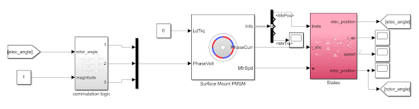
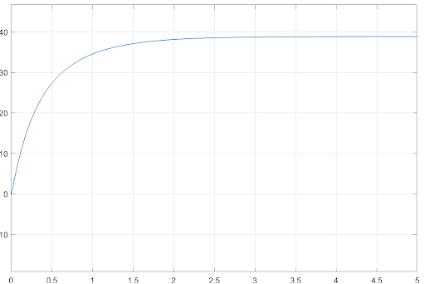
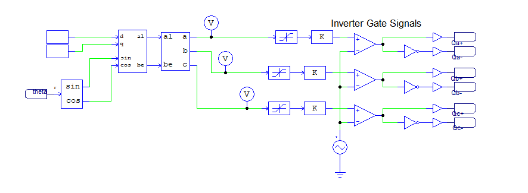
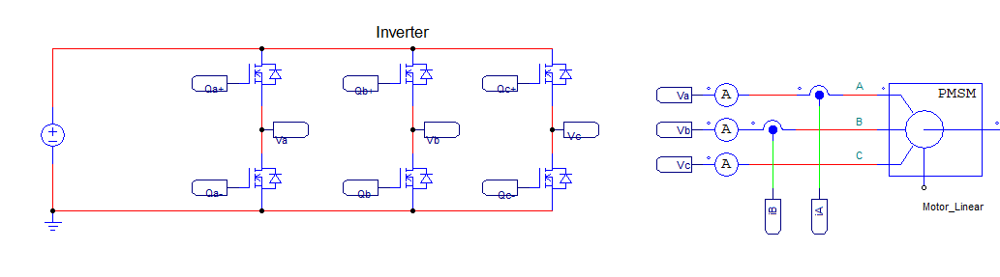
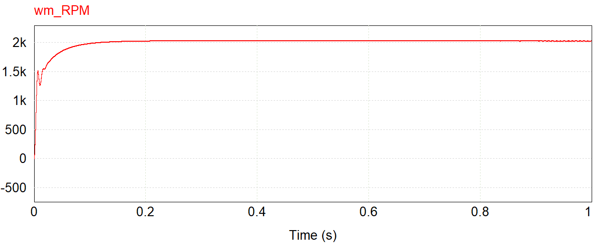
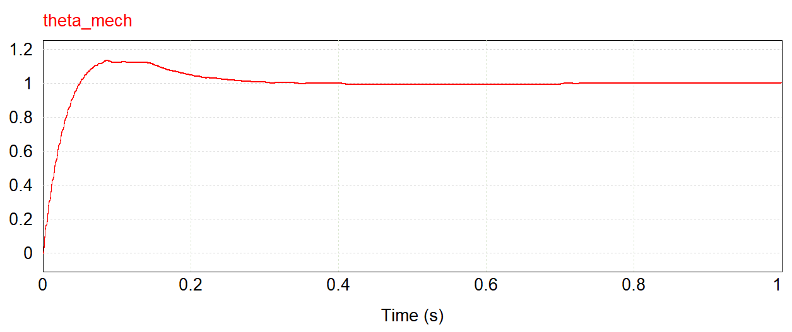

+++
title = "Pseudo-FOC Controller - Simulations and Initial Prototype"
date = 2022-01-18T16:40:00.000-08:00
tags = ["AC", "FOC", "Motor Drive", "PMSM Controller"]
+++

As a part of my FOC controller, I am developing an intermediate project - the *Pseudo-FOC Controller.* This post will introduce the theory, simulations, and an initial prototype of the project. At its core, this controller uses sinusoidal commutation, which is being implemented through the inverse Park and Clarke transforms.

## Project Goals

The goals of this project are listed below:

- Control torque, speed, and position of a PMSM - specifically for gimbal and drone grade motors
- Develop a PCB for the controller
- Develop auto-tuning algorithms for controller gains
- Develop an auto-calibration sequence for the rotor position sensor

## BLDC vs PMSM

A key point of confusion is motor classification of permanent magnet machines - specifically between *Brushless DC Motors* (BLDCs) and *Permanent Magnet Synchronous Motors* (PMSMs). In my experience/readings, the differing factors is in their back-emf profile: BLDCs having a trapezoidal BEMF and PMSMs having a sinusoidal BEMF.

It is also important to note that depending on the motor type, a different commutation scheme should be used in order to maximize torque production. For BLDCs, trapezoidal commutation should be used - in theory it allows for 0 torque ripple in the motor however due to harmonics in the trapezoidally wound motor, the BEMF is usually more sinusoidal, resulting in current ripples.

## Sinusoidal Commutation

For PMSMs, one way to drive the motor is to use *sinusoidal commutation*. Due to the sinusoidal BEMF, sinusoidal phase currents are needed to be generated. Since the BEMF is determined by the position of the rotor flux, a position sensor is required in order to generate these phase currents. The commutation scheme is noted below:

$$
i_a = -I sin(\theta)
$$

$$
i_b = -I sin(\theta - 120^o)
$$

$$
i_c = -I sin(\theta + 120^o)
$$

Where $i_a, i_b, i_c$ are the phase currents, $I$ is the magnitude, and where $\theta$ is the electrical position of the rotor (i.e. $\theta = P\theta_r$, with $P$ being the pole pairs and $\theta_r$ being the mechanical position of the rotor). The magnitude  of $I$ determines the torque output of the motor since $I$ is proportional to $tau$.

In practise, it is difficult to control current, so instead of commanding phase currents, phase voltages are used. The equations are then:

$$
v_a = -V sin(\theta)
$$

$$
v_b = -V sin(\theta - 120^o)
$$

$$
v_c = -V sin(\theta + 120^o)
$$

Again, the amplitude of the sinusoids controls torque since $v \ \alpha \ i \ \alpha \ \tau$. The following was simulated in Simulink:

The inputs to the system are the rotor angle, and the magnitude of the phase voltages - really the input is just magnitude since the rotor position is fed back from the sensor. Similar to a DC motor, by setting the voltage, the speed is changed too (along with torque):

## Pseudo-FOC

Using the inverse Clarke and Park transforms, the same behaviour can be achieved. To demonstrate, PSIM was used to also model the inverter dynamics. Here, the inputs are D and Q axis voltages. Similar to FOC, to maximize torque, the D axis is set to 0, and the Q axis controls to torque magnitude - just as in the sinusoidal commutation scheme above. For this reason I called it "Pseudo-FOC" - since it uses similar terms however it is not directly sampling torque through current sensors.

Above is the voltage based torque controller. After the Park/Clarke transforms, the three phase voltages are generated just as in sinusoidal commutation. These voltages are used as the command signals to generate PWM signals to drive the voltage source inverters for the motor:

Now that the torque can be controlled using the magnitude of the Q axis voltage, this can be cascaded to a speed loop, and also a position loop. This was also simulated for position control. For example, here is the response to a 1 radian setpoint:

The speed and position controller gains were not tuned very well, so this response could be improved in terms of bandwidth and overshoot, however as a proof of concept it delivers the point: using Pseudo-FOC, position and speed can accurately be controlled, and torque can too with voltage.

## Prototype

With the simulations validated, a prototype was developed. The PMSM being used is a TYI-Power 7025 420KV drone motor. For the power stage, a 3 phase inverter is being driven by a DRV8302 development board. Also, an Arduino is being used to perform the commutation logic.

The code will be uploaded later, however it just implements the inverse Clarke and Park transforms as in the simulation. However, a calibration sequence is needed to account for the offset when mounitng the encoder. Another post will be created later, however it is based on Ben Katz's work found here: <https://build-its-inprogress.blogspot.com/2017/03/encoder-autocalibration-for-brushless.html>.

Here is a quick demonstration running voltage torque control:


