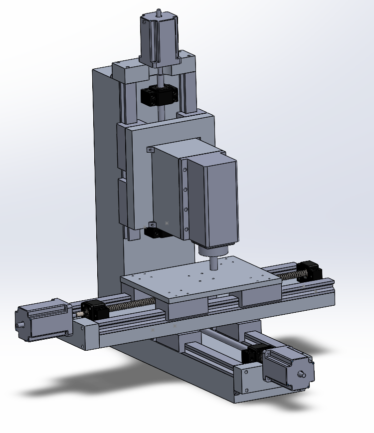
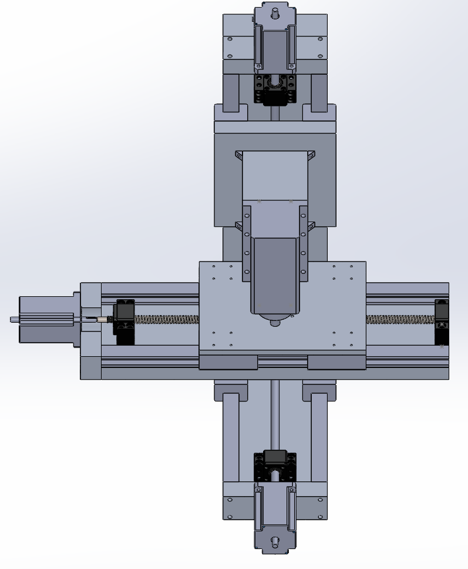
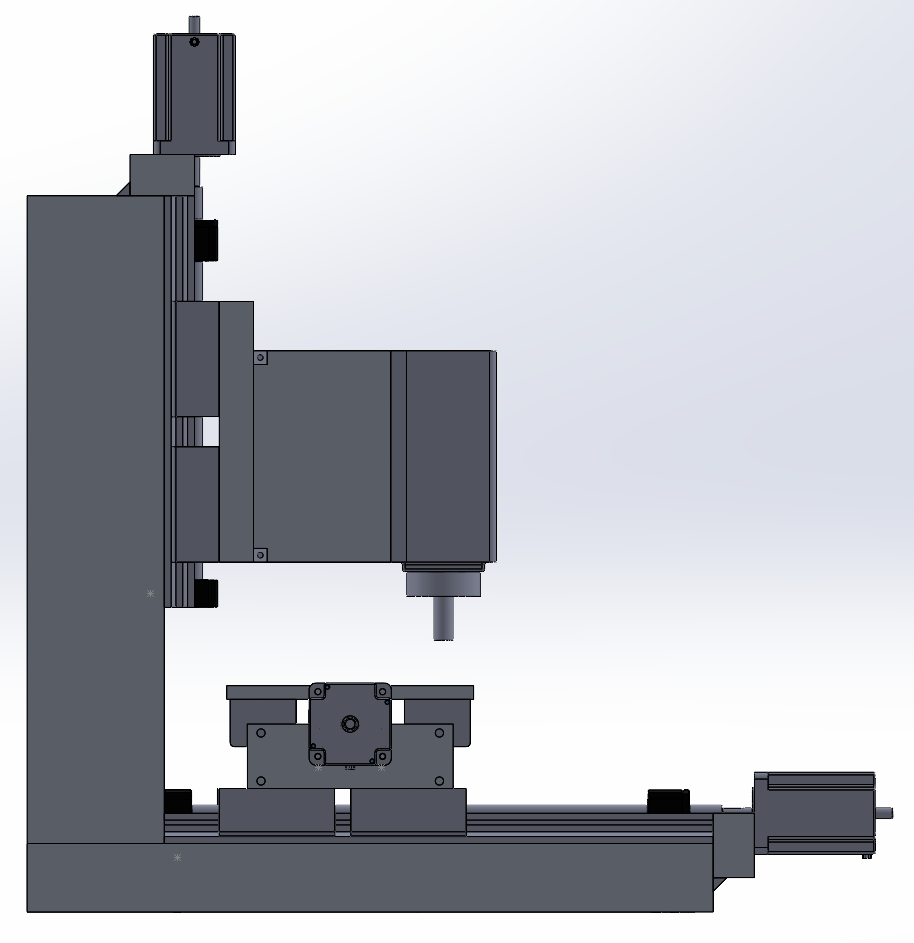

+++
title = "Revised CNC Mill Design"
date = 2021-09-15T12:48:00.003-07:00
tags = ["CAD", "CNC", "design", "mill", "project"]
+++

In the last post I fixed some of the clearance and parts issues for the x-axis assembly for the CNC mill. I since applied these same changes to all axes and dialed in most of the components. Here is a image of the full system:

*Version 2 of the CNC mill design.*

The entire assembly weighs 48 kg which is on the lighter side. To fix this I plan on casting epoxy granite around the y-axis base to add both mass and damping properties.

The work area is:

- X travel: 240 mm
- Y travel: 180 mm
- Z travel: 110 mm

### Parts

Each of the axes use SFU1204 ball screws, the only difference being the length: 500 mm on x, 400 mm on y, and 300 mm on z. Similar to this, all axes use HGR25 linear rails (a pair) and 4 HGH25-CA linear bearings (2 per rail). Again the only difference is the lengths: 500 mm on x, 400 mm on y, and 300 mm on z.

For the spindle I plan on using a 1.5 kW 110 V air cooled spindle and a VFD ([found here](https://www.aliexpress.com/item/32469085433.html?spm=a2g0o.search0304.0.0.61647e7aO65HmV&algo_pvid=2c57b768-4e0f-4fc1-80a2-cee2a758598e&algo_exp_id=2c57b768-4e0f-4fc1-80a2-cee2a758598e-13)). I modelled the dimensions in Solidworks (as seen above). The motors are just NEMA 27s, however I need to still correctly choose the torques and sizes for each axis.

For the metal/frame components, they are all 6061 aluminium bars. I have not settled on weather I will purchase precision ground bars or mill it myself yet. These will impact the price. Either way, for the x-axis it is a 25 x 150 x 500 mm aluminium bar, for the y base it is a 50 x 150 x 500 mm bar, and for the z column it is a 100 x 150 x 472 mm bar. The z-fixture is a 25 x 175 x 190 mm block while the spindle mount is a 94 x 100 x 154 mm block. I have to refine these in the design since they are not standard sizes - this will save some time and costs.

### Price

|  |  |  |  |
| --- | --- | --- | --- |
| Transmission |  |  |  |
| Name | Unit Price | Amount | Total |
| HGR25 (2x 500mm rails) | \$85.87 | 1 | \$85.87 |
| HGH25-CA (linear bearings) | \$21.24 | 4 | \$84.96 |
| SFU1204 ball screw kit (500mm) | \$37.70 | 1 | \$37.70 |
| HGR25 (2x 400mm rails) | \$79.86 | 1 | \$79.86 |
| HGH25-CA (linear bearings) | \$21.24 | 4 | \$84.96 |
| SFU1204 ball screw kit (400mm) | \$32.80 | 1 | \$32.80 |
| HGR25 (2x 300mm rails) | \$61.53 | 1 | \$61.53 |
| HGH25-CA (linear bearings) | \$21.24 | 4 | \$84.96 |
| SFU1204 ball screw kit (300mm) | \$24.76 | 1 | \$24.76 |
|  |  | Total | \$577.40 |
| Metals |  |  |  |
| Name | Unit Price | Amount | Total |
| X-Axis plate | \$52.58 | 2 | \$105.16 |
| Y-Axis base | \$116.69 | 2 | \$233.38 |
| Z-Axis column | \$217.33 | 1.8 | \$391.19 |
|  |  | Total | \$729.73 |
| Electronics |  |  |  |
| Name | Unit Price | Amount | Total |
| Spindle + VFD | \$230.00 | 1 | \$230.00 |
| NEMA 23 for Z | \$35.00 | 1 | \$35.00 |
| NEMA 23 for X and Z | \$28.18 | 2 | \$56.36 |
| Stepper driver | \$22.00 | 3 | \$66.00 |
|  |  | Total | \$387.36 |

\* In CAD

Here are some more images (I will upload the CAD files to drive later):

