+++
title = "Variable Frequency Drive for Induction Motors - Overview and Design"
date = 2021-11-16T20:28:00.000-08:00
tags = ["AC", "Induction Motor", "Motor Drive", "VFD"]
+++

I began a new project to design and construct a Variable Frequency Drive (VFD) for AC induction motors. The purpose of this project is for me to apply some of my power electronics knowledge of inverter design and also aid me in my FOC project since the power stage of this drive is similar (FOC just has more complex control algorithms). This post will cover some the high level design considerations and some preliminary simulation of the VFD.

### Background - Induction Motors

To me motor drives are super interesting as AC motors are used everywhere and they are the basis of many machines. More specifically, AC induction motors (invented by Nikola Tesla) are the most popular motor kind - 90% of motors used in industrial and commercial applications are induction type.

To see how a VFD works it is important to know how an induction motor works. At a high level, the induction motor, like many AC motors, is made up of a stator and a rotor. The stator is made up of windings - for a three-phase motor, three independent sets of windings separated by 120 degrees.

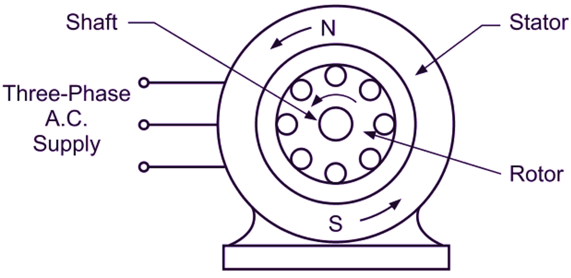

*An induction motor diagram ([source](https://electricalworkbook.com/wp-content/uploads/2021/06/Three-Phase-Induction-Motor-1.png))*

The rotor is made up of conducting bars and laminations - a popular rotor construction is a squirrel cage type for induction motors. For operation, due to Faraday's law, when a current is passed through the stator windings, a magnetic field is induced - if this current is sinusoidal it creates a rotating magnetic field (RMF) in the stator. Due to this RMF, a current is induced in the rotor's conducting bars, which also create another magnetic field. The stator magnetic field rotates at the *synchronous speed*, given by:

$$
N_s = \frac{120f}{P} \ \ (RPM)
$$

With $P$ being the poles in the motor, and $f$ being the frequency of the sinusoidal current applied. The rotor field follows the RMF from the stator, thus it causes rotation. In practical scenarios the rotor speed always lags the synchronous speed - this is called slip. However, with the equation above, we can see that increasing the frequency will increase the synchronous speed and thus the rotor speed. This is the principle for a VFD - modulating the frequency will let us modulate the speed of the induction motor.

### VFD Power Stage

The VFD will specifically be a Voltage Source Inverter (VSI) PWM controlled VFD. It employs a relatively common topology:

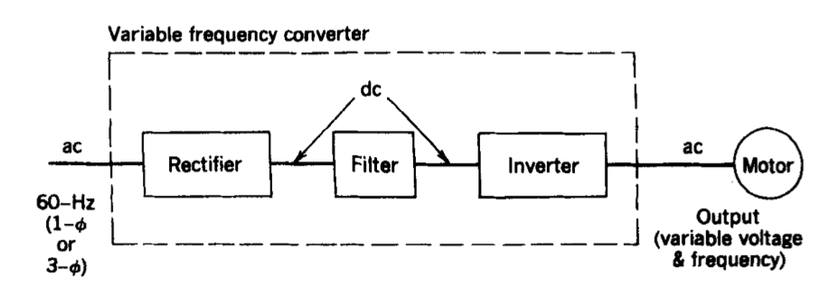

*VFD topology*

The system takes AC utility voltage (single- or three-phase). For this project, it will take a single phase input (60 Hz, 220 V RMS). The rectifier takes this AC line voltage and converts the sine wave to positive on all cycles. The DC bus, filters this to become a cleaner DC signal using a capacitor bank. Finally the three-phase inverter takes the DC bus voltage and converts back into a three-phase frequency and voltage controlled waveform.

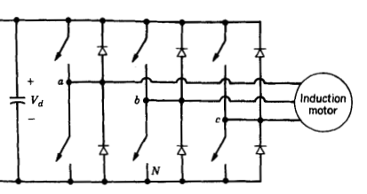

*The 3-phase inverter of the power stage*

The inverter switches are driven by a sinusoidal bipolar PWM switching scheme. Three 120 degree shifted sinusoidal are generated offline by a microcontroller and sent to the gate driver. The PWM signal can also be constructed in an analog fashion by using a triangle carrier wave and a comparator. These will be explained in the next section.

### Design Simulation

PSIM is used for simulation of the system. For this design, the Nidec T32P2AH induction motor is chosen as a place holder. It is a good solution that captures features seen in common induction squirrel cage motors.

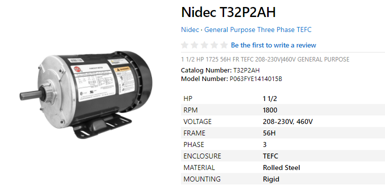

*The Nidec induction motor used for simulation ([source](https://www.emotorsdirect.ca/item/nidec-t32p2ah?quantity=1&tab=downloads-tab))*

It is a 4 pole motor with a rated current of 4.5 A. When actually implementing this, a single phase induction motor will be used for cost effectiveness. This means that the power stage will need to be modified to be a full-bridge inverter instead of the three-phase simulated.

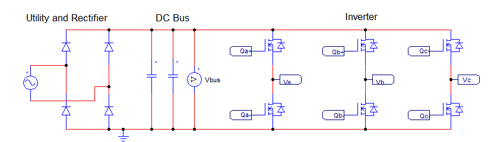

*Simulated power stage in PSIM*

From left to right we see the utility, rectifier, DC bus, and inverter circuits just as in the high level diagram. In a lower-level simulation software such as LTSpice, the N-Channel MOSFETs will need a bootstrapping circuit to properly demonstrate the high-side driving. In the practical construction a dedicated gate driver IC will be used such as the TI DRV8302 or DRV8323. Below is the bipolar SPWM switching signals. The current carrier frequency, and resulting switching frequency is 10 kHz.

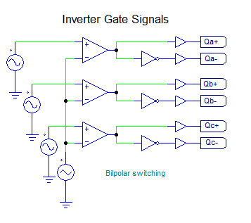

Bipolar SPWM gate signals

By modifying the three sinusoidal signals the frequency and torque of the motor can be controlled. For instance, a higher modulation index ($m_a$) will result in a higher output current, and thus output torque at the rotor. By adjusting the frequency of each signal (they all must be the same however), the speed can be controlled as mentioned above. In reality, a microcontroller will be responsible for generating these driving signals.

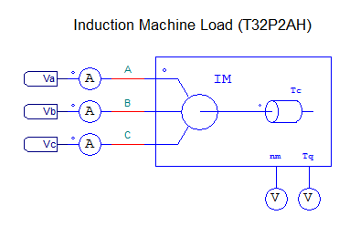

Model of the Nidec induction motor

#### Selecting DC Bus Capacitors

The bus capacitors filter the incoming rectified AC utility signal and are responsible for creating a smooth DC bus voltage for the inverter. To select a capacitor for a desired current ripple the equation for current in a capacitor needs to be examined:

$$
i_c = C \frac{dv_c}{dt}
$$

Taking the integral...

$$
v_c = \frac{1}{C}\int i_c dt
$$

Then in the average domain...

$$
I = C \frac{\Delta V_c}{\Delta t}
$$

Rearranging for and knowing the full bridge frequency is twice the input...

$$
C = \frac{I}{2F_{in}\Delta V_o}
$$

Now the if the desired voltage ripple is 1 V (the input is 220 V RMS so this is < 1% ripple), and knowing the rated current is 4.5 A, so going to 10 A as a safety factor, the capacitor needed is:

$$
C = \frac{10 A}{2 \cdot 60 Hz \cdot 1 V} = 83.3 mF
$$

### Results

Here are the simulation results. The AC utility input is 220 V RMS, and is rectified to ~310 V using the bus capacitors selected above. Also, for this simulation, no load is present on the rotor. Below is the speed response.

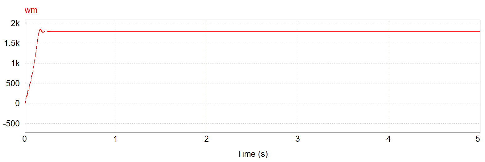

*Speed of motor at a 60 Hz control frequency*

After the 1.8 ms transient, the speed reaches 1800 RPM. This shows that there is 0 slip which makes sense as there is no load. Next the phase currents:

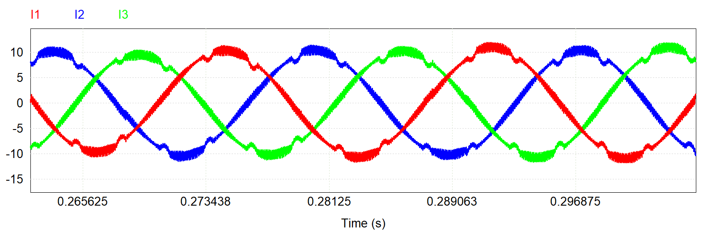

*Steady-state response of phase currents*

At steady-state, the currents are three 120 degree phase shifted sine waves as expected - this will cause the RMF. There is a peak current ripple at 0.7 A which can be reduced by increasing the carrier wave frequency at the loss of inverter efficiency. This needs further optimisation as the MOSFET switching losses have not been computed as of yet.

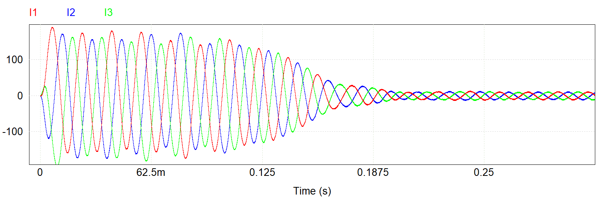

*Transient response of phase currents*

Looking at the transient response, it can be seen that a large current spike occurs; this current is far more than the rated current for the motor. This *inrush current* is can be mitigated by adding a soft-starter or soft-charge circuit.

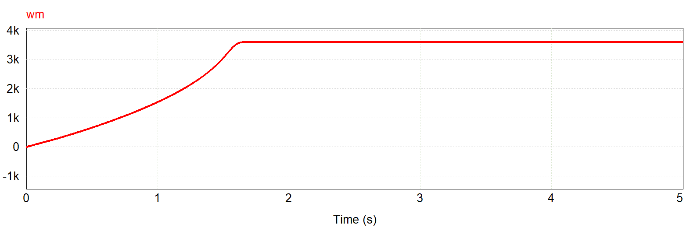

*Speed of motor at a 120 Hz control frequency*

Also by modulating the control waveform frequency, the speed increases as expected. Here at steady-state, the rotor runs at 3600 RPM at 120 Hz - the frequency was doubled and so did the speed. Also, by changing the modulation index of the control wave, the current can be controlled, which also means output torque can be controlled. For example at an $m_a=0.5$ the steady-state phase current was 5 A in amplitude while at $m_a=1$ it was at ~10 A.

### Next Steps

Many things still need to be done before developing the physical prototype, such as:

- Refine VFD requirements
- Create the soft-charge bypass circuit to limit in-rush current
- High side N-Channel MOSFET bootstrap
