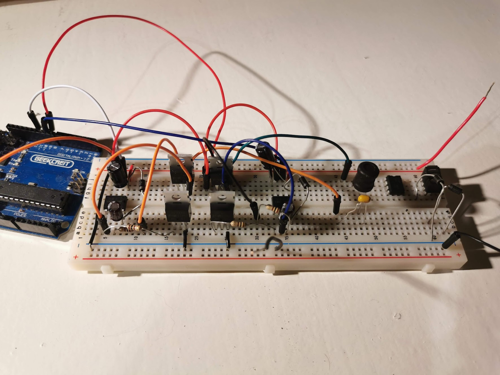
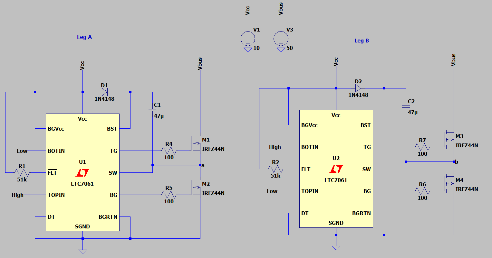
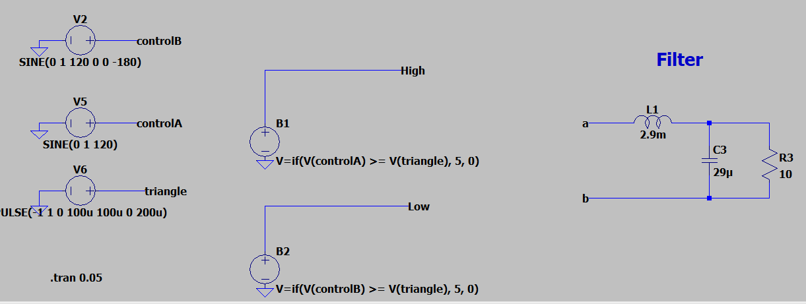
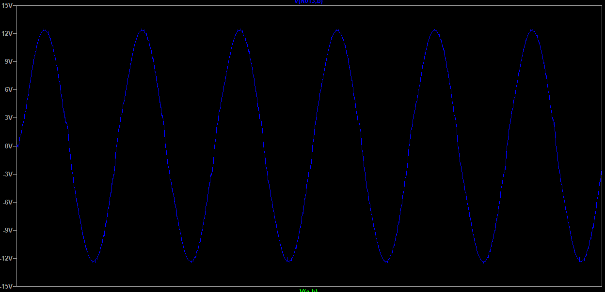
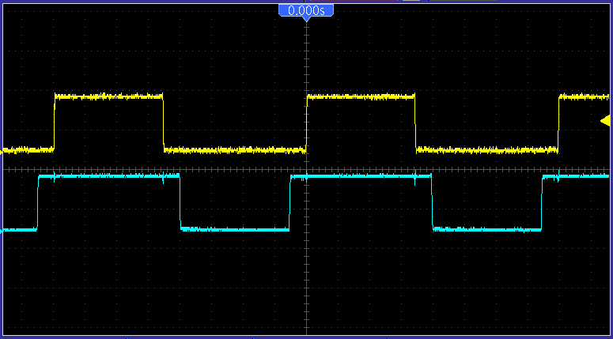
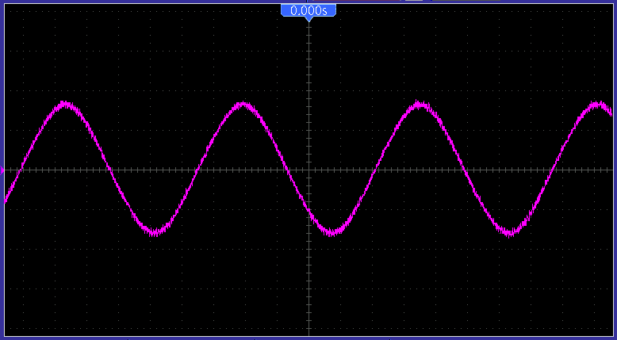

+++
title = "VFD Inverter Prototyping"
date = 2021-11-24T22:49:00.002-08:00
tags = ["AC", "FOC", "Induction Motor", "Motor Drive", "project", "VFD"]
+++

I began prototyping the VFD circuit discussed in the previous post, specifically the inverter stage. I modified it to be a single-phase full bridge inverter instead of the three-phase simulated. This is due to me using a single-phase shaded pole induction motor for testing down the line - 120 V, 60 Hz on the nameplate. Here is an image of the circuit:

*Full-bridge inverter circuited*

Before making the circuit, I simulated the inverter in LTSpice. Similar to the PSIM simulation, a bipolar switching scheme is being generated for the SPWM signal.

*Inverter legs and gate driver ICs*

*Bipolar PWM generation and output filter*

For the spice simulation, LTC7061 half-bridge MOSFET drivers are being used. In the actual circuit I sourced IR2104 gate drivers however they both do the same thing so I opted to use the default Analog Devices IC in LTSpice.

#### **Picking Bootstrap Capacitors**

The gate driver ICs require a bootstrap capacitor and diode. For the diode I picked a standard 1N4148/1N4007. However, to pick the bootstrap capacitor it is slightly more involved. According to TI ([linked here](https://www.ti.com/lit/an/slua887/slua887.pdf?ts=1637078729627&ref_url=https%253A%252F%252Fwww.google.com%252F)) the bootstrap capacitor should be:

$$
C_{boot} > 10 C_{gate}
$$

To get the gate capacitance:

$$
C_{gate} = \frac{Q_{gate}}{V_{cc} - V_{f}}
$$

With $V_{f}$ being the forward voltage drop accross the diode, and $Q_{gate}$ being the gate charge. For the IRFZ44N, the gate charge is 65 nC, thus:

$$
C_{gate} = \frac{65 nC}{12V - 1V} = 5.9 pC
$$

To get $C_{boot}$, I set it to the common 47 uC capacitor so this can be a lower switching frequency application.

#### Filter Calculation

For the implementation, the AC motor acts as the bipolar filter, however for simulation speeds, an LC filter was added to analyse the output waveform. Here are the two equations used to find L and C:

$$
F_c = \frac{1}{2 \pi \sqrt{LC}}
$$

$$
R_{load} = \sqrt{\frac{L}{C}}
$$

Since the output waveform will be under ~500 Hz (due to the rated motor speed), the switching frequency needs to be cut out - here it is 10 kHz. Thus, the midpoint is ~550 Hz. This is the cutoff frequency.

$$
L = 2.9 mH
$$

$$
C = 29 \mu F
$$

#### LTSpice Results

*Filtered output wave*

The output waveform has a peak of 12 V (this will be stepped-up to 120 V RMS using a transformer to drive the AC motor), and a ~60 Hz frequency.

#### Circuit Results

#### Similarly, in the practical prototype, we can see that the bipolar PWM switching is working as intended. Below are the signals for each of the legs, as it can be seen, the duty cycles are  opposites of each other.

*Inverter leg voltages*

For the output voltage it is a 12 V peak, meaning it is correctly inverting the 12 V DC input.

*Filtered output wave*
