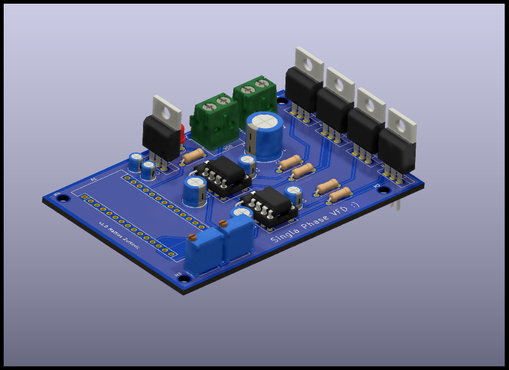
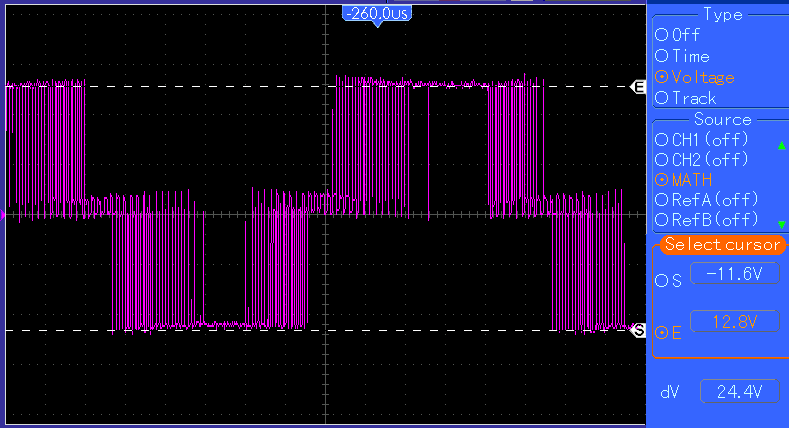
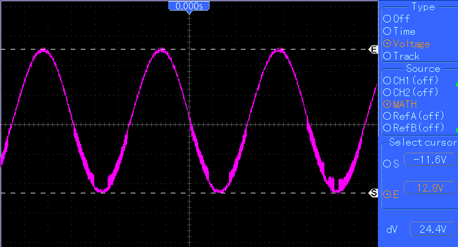
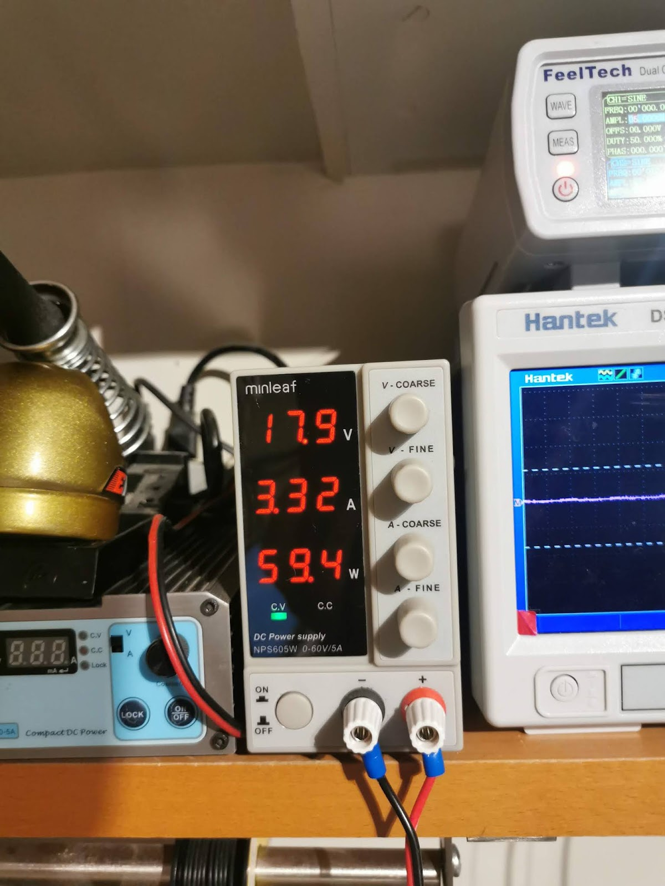
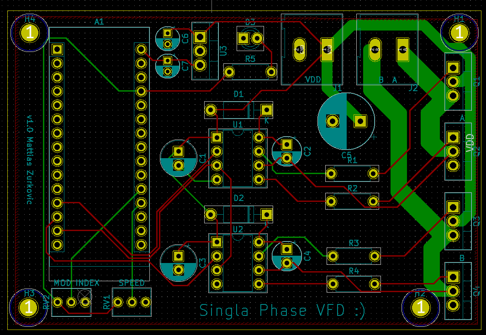

+++
title = "VFD Updates - More Prototyping and PCB Design"
date = 2021-12-01T21:56:00.003-08:00
tags = ["AC", "design", "Induction Motor", "Motor Drive", "PCB", "VFD"]
+++

Several things have been done since the initial prototype: the prototype has been further tested, the motor has been validated, and the PCB has been designed and sent to the FAB. Here is an image of the rendered board:

*The PCB render*

### Prototype Validation

The prototype has been changed - specifically gate and pull-down resistors were added. A big change is that the inverter generates a 12 V peak to peak signal which is then boosted up to 120 V RMS by a transformer and powers the motor. This was done instead of having a 120 V sine wave be generated as an isolated power supply would be needed for the logic components, however the current being drawn at the inverter stage is significantly higher. Here are some key waveforms generated by the inverter.

*The switching voltage between inverter legs A and B*

*The filtered output voltage*

The firmware is running a 100% modulation index, thus showing that the output wave has peaks of $\pm V_{dc}$ or $\pm 12 V$. The frequency can also be modulated to change motor speeds. Looking at the switching voltage, it can be seen that a unipolar switching scheme is being used - this is due to the inverting input on the IR2104 driver.

After validating the inverter, the output is sent to a transformer and finally the motor. Here is a common 120 V 1.5 A single phase induction motor being powered.

<iframe src="https://www.blogger.com/video.g?token=AD6v5dx1HUHwx9ykeMCYF3DAju_QPuDd5EUZKZ5Nu3K9e3zsmSpwCV67fP80xcDuwnSrw3VtQahz-JTW3wsiJ5cU5w" width="640" height="360" allowfullscreen></iframe>

Since the load can draw up to 1.5 A, due to the transformer, the inverter needs to supply $1.5 A \frac{N_s}{N_p} \approx 20 A $. When running the system with no load on the rotor, the inverter stage pulled 59.4 W:

This 3.32 A of current is quite high for the breadboard to handle and it was getting very hot - I chose to design a PCB to remedy this such that further testing can be done.

### PCB Design

The schematic and PCB were designed in KiCAD. It is a relatively simple design - it consists of the MOSFET power stage, the two IR2104 drivers, and an Arduino Nano to generate the SPWM signals. Here is the final layout of the board (the 3D view can be seen at the top).

Yes, I realise that this is for a *Sigla Phase VFD* not Single Phase one...
